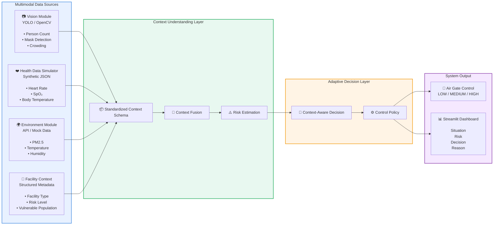
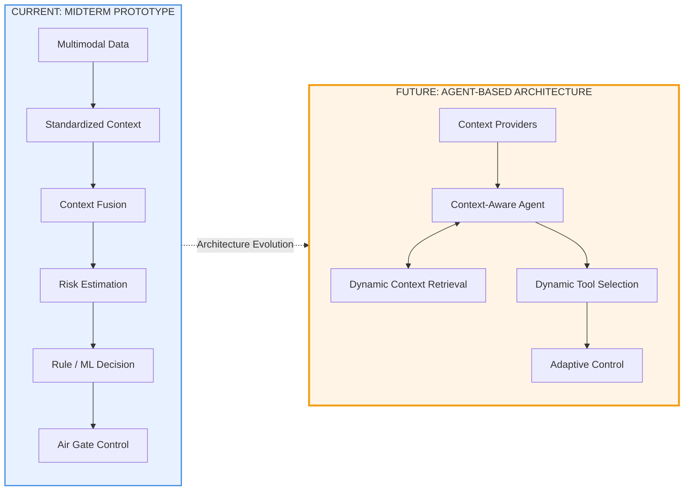
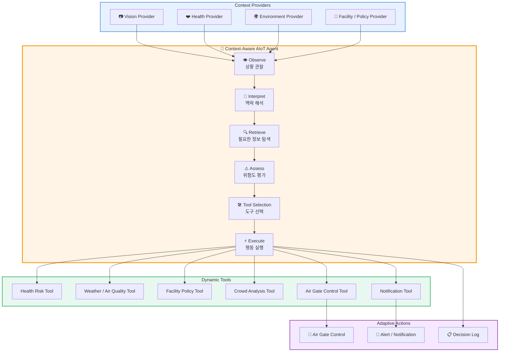
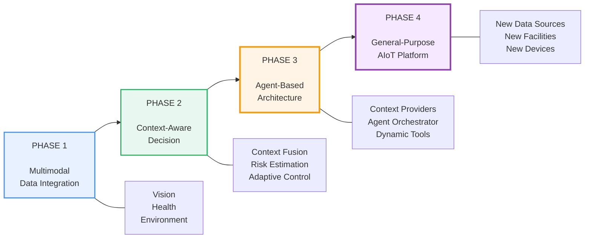

# DNA-HERO Midterm Prototype Plan

> **Multimodal Context-Aware AIoT System for Adaptive Air Gate Control**

---

## 1. Project Overview

본 프로젝트는 카메라 기반 시각 정보, 생체 정보, 환경 정보 및 시설 맥락을 통합하여 사용자가 처한 상황을 종합적으로 이해하고, 상황에 적합한 에어게이트 제어를 수행하는 **Context-Aware AIoT 시스템**을 구현하는 것을 목표로 한다.

기존의 단순한 센서 기반 제어는 개별 센서값에 직접 규칙을 적용한다.

```text
Heart Rate > 120
        ↓
Air Gate HIGH
```

그러나 동일한 센서값이라도 사용자의 상태와 시설의 맥락에 따라 의미가 달라질 수 있다.

```text
Heart Rate = 120

Gym
→ Physical Activity 가능성

Hospital
→ Health Risk 가능성
```

따라서 본 프로젝트에서는 단순히 데이터를 수집하는 것이 아니라,

```text
Raw Data
    ↓
Context Understanding
    ↓
Risk Estimation
    ↓
Adaptive Decision
    ↓
Air Gate Control
```

의 구조를 구현하는 것을 핵심 방향으로 설정한다.

---

# 2. Research Question

## Main Research Question

> **동일한 멀티모달 센서 데이터라도 사용자·환경·시설 맥락을 함께 고려할 경우, 고정된 규칙 기반 제어보다 상황에 적합한 제어가 가능한가?**

---

## Sub Questions

### Q1. Multimodal Data Integration

카메라, 생체정보, 환경정보와 같은 서로 다른 데이터 소스를 하나의 표준화된 Context로 통합할 수 있는가?

### Q2. Context-Aware Decision

동일한 센서 데이터라도 시설 및 환경 맥락에 따라 서로 다른 위험도와 제어 결과를 생성할 수 있는가?

### Q3. Extensibility

새로운 데이터 소스나 시설 유형이 추가되었을 때 중앙 판단 로직을 크게 수정하지 않고 시스템을 확장할 수 있는가?

---

# 3. Midterm Prototype Goal

중간발표까지는 실제 완성품을 만드는 것이 아니라, 다음의 핵심 가설을 검증하는 것을 목표로 한다.

> **멀티모달 데이터를 통합하여 사용자·환경·시설의 맥락을 추론하고, 그 결과에 따라 적응형 에어게이트 제어를 수행할 수 있다.**

따라서 실제 하드웨어의 완전한 구현보다 다음의 전체 파이프라인을 구현한다.

```text
Vision Data
     +
Health Data
     +
Environment Data
     +
Facility Context
        ↓
Context Fusion
        ↓
Risk Estimation
        ↓
Context-Aware Decision
        ↓
Air Gate Control Simulation
        ↓
Dashboard
```

---

# 4. Overall Prototype Architecture



---

# 5. Data Modules

## 5.1 Vision Module

실제 카메라 또는 영상 데이터를 활용하여 시각 정보를 추출한다.

### Target Information

* 출입 인원 수
* 얼굴 검출 여부
* 마스크 착용 여부
* 혼잡도
* 사용자 위치

### Example

```json
{
  "person_count": 8,
  "mask_rate": 0.5,
  "crowding_level": "HIGH"
}
```

### Implementation

```text
Video / Camera
      ↓
YOLO / OpenCV
      ↓
Object Detection
      ↓
Vision Context
```

---

## 5.2 Physiological Data Module

현재 실제 웨어러블 디바이스 및 BLE 센서를 확보하지 못한 상황을 고려하여, 실제 센서 데이터 포맷을 모사한 **Synthetic JSON Data**를 생성한다.

이 데이터는 실제 센서 데이터를 대체하는 것이 아니라, 향후 BLE 기반 헬스 디바이스가 연결되는 상황을 가정한 프로토타입 데이터이다.

### Example

```json
{
  "device_id": "wearable_001",
  "heart_rate": 120,
  "spo2": 94,
  "body_temperature": 38.1,
  "stress_index": 78,
  "timestamp": "2026-07-23T22:00:00"
}
```

---

## 5.3 Scenario-Based Health Data

단일 JSON 데이터를 사용하는 것이 아니라, 여러 상황을 시뮬레이션한다.

### Normal Scenario

```json
{
  "heart_rate": 75,
  "spo2": 98,
  "body_temperature": 36.5,
  "stress_index": 20
}
```

### Physical Activity Scenario

```json
{
  "heart_rate": 125,
  "spo2": 98,
  "body_temperature": 36.8,
  "stress_index": 70
}
```

### High Risk Scenario

```json
{
  "heart_rate": 125,
  "spo2": 94,
  "body_temperature": 38.1,
  "stress_index": 85
}
```

이러한 시나리오를 통해 시스템이 서로 다른 사용자 상태를 어떻게 해석하는지 검증한다.

---

## 5.4 Environment Module

외부 API 또는 Mock Data를 활용하여 환경 정보를 수집한다.

### Target Information

* 기온
* 습도
* 미세먼지
* 초미세먼지
* 대기 상태
* 강수 여부

### Example

```json
{
  "temperature": 32,
  "humidity": 80,
  "pm25": 85,
  "air_quality": "BAD"
}
```

### Data Strategy

```text
Real API
    +
Offline Mock Data
```

실제 API 연동이 가능하면 사용하되, 발표 및 데모의 안정성을 위해 Offline Mock Data를 함께 준비한다.

---

## 5.5 Facility Context

에어게이트가 설치된 공간의 특성을 구조화하여 저장한다.

### Example

```json
{
  "facility_type": "hospital",
  "risk_level": "HIGH",
  "vulnerable_population": true
}
```

### Target Facilities

* 일반 사무실
* 병원
* 어린이집
* 학교
* 공장
* 공공기관

시설마다 동일한 센서 데이터가 서로 다른 의미를 가질 수 있도록 한다.

---

# 6. Standardized Context Schema

각 데이터 모듈의 결과를 통합하기 위해 표준화된 Context Schema를 사용한다.

```json
{
  "timestamp": "2026-07-23T22:00:00",

  "vision_context": {
    "person_count": 8,
    "mask_rate": 0.5,
    "crowding_level": "HIGH"
  },

  "health_context": {
    "heart_rate": 120,
    "spo2": 94,
    "body_temperature": 38.1,
    "stress_index": 78
  },

  "environment_context": {
    "temperature": 32,
    "humidity": 80,
    "pm25": 85,
    "air_quality": "BAD"
  },

  "facility_context": {
    "facility_type": "hospital",
    "risk_level": "HIGH",
    "vulnerable_population": true
  }
}
```

이 구조의 목적은 각 데이터 소스와 판단 로직을 분리하는 것이다.

```text
Vision Module
      ↓
VisionContext

Health Module
      ↓
HealthContext

Environment Module
      ↓
EnvironmentContext

Facility Module
      ↓
FacilityContext
```

향후 Agent Architecture로 확장할 때에도 이 Context Schema를 그대로 활용할 수 있다.

---

# 7. Context Fusion

각각의 센서값을 단순히 나열하는 것이 아니라, 여러 Context를 통합하여 현재 상황을 추론한다.

## Input

```text
Heart Rate: 120
SpO2: 94
Body Temperature: 38.1
PM2.5: 85
Person Count: 8
Facility: Hospital
```

## Context Fusion

```text
Health Context
        ↓
User Risk: HIGH

Environment Context
        ↓
Environmental Risk: HIGH

Vision Context
        ↓
Crowding Level: HIGH

Facility Context
        ↓
Facility Risk: HIGH
```

## Integrated Context

```json
{
  "user_risk": "HIGH",
  "environment_risk": "HIGH",
  "crowding_level": "HIGH",
  "facility_risk": "HIGH",
  "overall_context": "HIGH_RISK_ENTRY"
}
```

최종적으로 시스템은 다음과 같은 상황을 인식한다.

> 의료시설 내에서 생체 이상 가능성이 있는 사용자가 고농도 미세먼지와 혼잡한 환경에 진입하고 있다.

---

# 8. Risk Estimation

Context Fusion 결과를 기반으로 각 위험도를 추정한다.

```text
Health Data
     ↓
User Risk

Environment Data
     ↓
Environmental Risk

Vision Data
     ↓
Crowding Risk

Facility Data
     ↓
Facility Sensitivity
```

### Example

```json
{
  "user_risk": "HIGH",
  "environment_risk": "HIGH",
  "crowding_risk": "MEDIUM",
  "facility_risk": "HIGH"
}
```

최종 상황:

```text
Overall Risk = HIGH
```

---

# 9. Context-Aware Decision

중간발표에서는 Rule-based 또는 간단한 ML 기반 Decision Layer를 구현한다.

```python
if user_risk == "HIGH" and environment_risk == "HIGH":
    control_level = "HIGH"

elif user_risk == "MEDIUM" or crowding_level == "HIGH":
    control_level = "MEDIUM"

else:
    control_level = "LOW"
```

단, 원시 센서값에 직접 규칙을 적용하지 않고 다음의 계층 구조를 유지한다.

```text
Raw Data
    ↓
Context Extraction
    ↓
Risk Estimation
    ↓
Decision
    ↓
Control
```

---

# 10. Core Demonstration Scenario

중간발표에서 가장 중요한 데모는 **동일한 센서 데이터라도 시설 맥락에 따라 판단 결과가 달라지는 것**이다.

---

## Scenario A: Office

### Input

```text
Heart Rate: 120
SpO2: 98
Body Temperature: 36.8
Facility: Office
```

### Interpretation

```text
Temporary Physical Activity Possible
```

### Decision

```text
Air Gate Level: MEDIUM
```

---

## Scenario B: Hospital

### Input

```text
Heart Rate: 120
SpO2: 98
Body Temperature: 36.8
Facility: Hospital
```

### Interpretation

```text
Potential Abnormal Physiological State
in a High-Sensitivity Facility
```

### Decision

```text
Air Gate Level: HIGH
```

---

## Core Message

> **동일한 센서 데이터라도 사용자·환경·시설의 맥락에 따라 의미가 달라질 수 있다.**

이것이 본 프로젝트의 핵심인 **Context-Aware Decision**이다.

---

# 11. Prototype Dashboard

최종 프로토타입은 Jupyter Notebook에 국한되지 않고 Streamlit 기반의 애플리케이션 형태로 구현한다.

## Dashboard Layout

```text
┌─────────────────────────────────────────────┐
│          DNA-HERO AIoT Dashboard             │
├─────────────────────────────────────────────┤
│                                             │
│  VISION                                     │
│  Person Count: 8                            │
│  Crowding: HIGH                             │
│                                             │
│  HEALTH                                     │
│  Heart Rate: 120 bpm                        │
│  SpO2: 94%                                  │
│  Temperature: 38.1℃                         │
│                                             │
│  ENVIRONMENT                                │
│  PM2.5: 85                                  │
│  Temperature: 32℃                           │
│                                             │
├─────────────────────────────────────────────┤
│                                             │
│  CURRENT CONTEXT                            │
│  🔴 HIGH RISK SITUATION                     │
│                                             │
│  Hospital                                   │
│  + High Pollution                           │
│  + Health Risk                              │
│  + High Crowding                            │
│                                             │
├─────────────────────────────────────────────┤
│                                             │
│  AIR GATE CONTROL                           │
│  Level: HIGH                                │
│  Confidence: 87%                           │
│                                             │
│  REASON                                     │
│  • Elevated heart rate                      │
│  • Low SpO2                                 │
│  • High body temperature                    │
│  • High PM2.5                               │
│  • Medical facility context                 │
│                                             │
└─────────────────────────────────────────────┘
```

---

# 12. Midterm Implementation Scope

## Must Implement

* [ ] Vision Data Collection
* [ ] Synthetic Health Data Generator
* [ ] Environment API or Mock Data
* [ ] Facility Context Definition
* [ ] Standardized Multimodal Context Schema
* [ ] Context Fusion
* [ ] Risk Estimation
* [ ] Context-Aware Decision
* [ ] Air Gate Control Simulation
* [ ] Streamlit Dashboard
* [ ] Scenario Switching
* [ ] Decision Reason Display

---

## Out of Scope for Midterm

* [ ] Real Wearable BLE Device Integration
* [ ] Real IR Camera-Based Temperature Measurement
* [ ] Real Air Gate Hardware Control
* [ ] Large-Scale ML Model Training
* [ ] Full Agent Architecture
* [ ] Fully Autonomous LLM-Based Control

---

# 13. Current Architecture vs Future Architecture



---

# 14. Limitations of the Current Rule-Based Architecture

현재 프로토타입은 사람이 직접 판단 규칙을 정의한다.

```text
IF
    Heart Rate > 120
AND
    SpO2 < 95
AND
    Facility = Hospital

THEN
    Air Gate Level = HIGH
```

이 구조는 초기 프로토타입에서는 명확하고 안정적이지만, 다음과 같은 한계를 가진다.

### Limitations

* 새로운 데이터 소스가 추가될 때마다 규칙 수정 필요
* 새로운 시설 유형마다 별도의 규칙 필요
* 예상하지 못한 복합 상황에 대한 대응 어려움
* 데이터 간 관계를 유연하게 해석하기 어려움
* 시스템 규모가 커질수록 Rule Explosion 발생

---

# 15. Future Direction: Agent-Based Context-Aware Architecture

향후에는 각 데이터 소스를 독립적인 **Context Provider** 및 **Tool**로 추상화한다.



---

# 16. Agent Workflow

## Example Situation

```text
Heart Rate: 120
SpO2: 94
PM2.5: 85
Facility: Hospital
Crowding: High
```

## Agent Process

```text
1. Observe Current Context
        ↓
2. Interpret Current Situation
        ↓
3. Retrieve Required Context
        ↓
4. Assess Health and Environmental Risk
        ↓
5. Check Facility Policy
        ↓
6. Select Appropriate Tool
        ↓
7. Execute Air Gate Control
        ↓
8. Generate Decision Log
```

---

# 17. Dynamic Tool Architecture

```text
Agent
│
├── get_health_context()
│
├── get_environment_context()
│
├── get_facility_policy()
│
├── analyze_crowding()
│
├── estimate_risk()
│
├── control_air_gate()
│
└── notify_manager()
```

새로운 데이터 소스가 추가되는 경우:

```text
New Sensor
    ↓
Standard Context Schema
    ↓
New Tool
    ↓
Agent Integration
    ↓
Context-Aware Decision
```

기존 Rule-Based Architecture에서는 중앙 판단 로직을 수정해야 하지만, Agent Architecture에서는 새로운 Context Provider 또는 Tool을 추가하는 방식으로 확장하는 것을 목표로 한다.

---

# 18. Why Agent Architecture?

단순한 단일 목적 시스템에서는 고정된 Rule-Based 시스템이 더 빠르고 안정적일 수 있다.

따라서 본 프로젝트에서 Agent를 사용하는 이유는 단순히 LLM을 적용하기 위해서가 아니다.

### Target Problem

```text
New Data Source
        ↓
New Facility
        ↓
New Risk Situation
        ↓
New Control Device
```

가 지속적으로 추가되는 상황에서,

```text
Central Rule Logic
        ↓
Continuous Modification
        ↓
Rule Explosion
```

이 발생하는 문제를 완화하는 것이다.

향후에는:

```text
Context Providers
        ↓
Standardized Schema
        ↓
Agent
        ↓
Dynamic Tool Selection
        ↓
Adaptive Control
```

의 구조를 목표로 한다.

---

# 19. Long-Term Research Direction

본 프로젝트의 장기적인 목표는 단순한 센서 통합 시스템이 아니다.

```text
Sensor Data
      ↓
Context
      ↓
Situation Understanding
      ↓
Risk Assessment
      ↓
Tool Selection
      ↓
Adaptive Control
```

의 구조를 갖는 **Context-Aware AIoT Agent**를 구축하는 것이다.

이를 통해 다음과 같은 다양한 환경으로 확장할 수 있다.

* 병원
* 학교
* 공장
* 어린이집
* 사무실
* 공공기관

각 시설마다 모든 규칙을 사람이 직접 작성하는 대신, 표준화된 Context와 Tool을 기반으로 Agent가 상황을 해석하고 적절한 행동을 선택하는 구조를 지향한다.

---

# 20. Development Roadmap



---

# 21. Final Research Narrative

## Midterm

> **멀티모달 데이터를 통합하고 사용자·환경·시설의 맥락을 고려하여 상황 기반 에어게이트 제어가 가능한지 검증한다.**

```text
Multimodal Data
        ↓
Context Fusion
        ↓
Risk Estimation
        ↓
Context-Aware Decision
        ↓
Air Gate Control
```

---

## Future

> **고정된 규칙 기반 의사결정의 한계를 극복하기 위해, 각 데이터 소스를 Context Provider와 Tool로 추상화하고 Agent가 상황에 따라 필요한 정보를 동적으로 활용하는 범용 AIoT Architecture로 확장한다.**

```text
Context Providers
        ↓
Context-Aware Agent
        ↓
Dynamic Context Retrieval
        ↓
Dynamic Tool Selection
        ↓
Adaptive Control
```

---

# 22. One-Line Summary

> **현재는 멀티모달 데이터를 기반으로 상황을 이해하는 Context-Aware AIoT Prototype을 구현하고, 향후에는 Agent가 다양한 Context와 Tool을 동적으로 활용하는 범용 AIoT Architecture로 확장한다.**

---

# 23. Vision Context Demo

영상에서 현재 인원 수, 마스크 착용 비율과 혼잡도를 추출하고 영상 재생
시점에 맞춰 Context JSON을 표시하는 Streamlit 데모이다.

## Setup

Python 3.10 이상을 권장한다.

```bash
python -m venv .venv
source .venv/bin/activate
pip install -r requirements.txt
```

## Run

```bash
streamlit run realtime_vision_app.py
```

사이드바에서 MP4, MOV, AVI, MKV 파일을 직접 업로드할 수 있다. 사용 권한이
있는 3분 이하 YouTube URL도 입력할 수 있으나, 발표 시에는 네트워크 장애를
피하기 위해 파일 업로드 방식을 권장한다.

분석 결과는 다음 표준 형식으로 제공된다.

```json
{
  "person_count": 8,
  "masked_person_count": 4,
  "mask_rate": 0.5,
  "crowding_level": "HIGH"
}
```

## Test

```bash
python -m unittest discover -s tests -v
```
