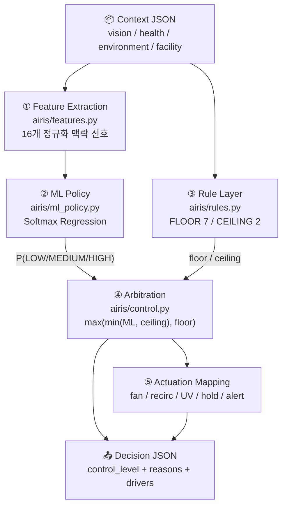

# Adaptive Control Logic — ML + Rule Hybrid Decision Layer

> 표준화된 Context JSON 하나를 입력받아 에어게이트 제어 수준과 액추에이터 설정값을 산출하는 판단 계층의 설계 문서.
>
> 시나리오별 실제 실행 결과는 [SCENARIO_PLAYBOOK.md](SCENARIO_PLAYBOOK.md)에 분리해 두었다.

---

## 1. 왜 ML 단독도, 규칙 단독도 아닌가

`README.md`의 연구 질문은 "동일한 센서값이라도 맥락에 따라 다른 제어가 필요한가"이다. 이를 구현하려면 두 가지 성질이 동시에 필요한데, 한 가지 방식으로는 둘 다 만족시킬 수 없다.

| 요구 성질 | 규칙 기반 | ML 기반 |
| --- | --- | --- |
| 다수 모달리티의 연속적·복합적 융합 | 조건문 조합이 폭발한다 | 잘한다 |
| 안전 임계선의 무조건 보장 | 보장한다 | 확률이라 보장 못 한다 |
| 판단 근거의 감사(audit) 가능성 | 규칙 ID로 추적된다 | 별도 설명 기법 필요 |
| 새로운 시설 유형 확장 | 규칙을 매번 추가 | 특징만 추가하면 재학습 |

따라서 본 시스템은 **ML이 연속적인 위험도 판단을 담당하고, 규칙이 그 출력의 상·하한을 강제하는** 하이브리드 구조를 채택한다. 규칙은 ML을 대체하지 않고 **경계 조건만 강제**한다.

실제로 이 구조가 필요한 이유는 실행 결과에서 관측된다. 시나리오 S7(산소포화도 91%)에서 ML은 `LOW`(신뢰도 56%)를 예측했으나 하한 규칙 F1이 이를 `HIGH`로 상향 고정했다. 선형 모델이 단일 지표의 임계선 위반을 과소평가한 사례이며, 이런 실패는 확률 모델에서 완전히 제거할 수 없다.

---

## 2. 전체 파이프라인



원시 센서값은 ML에 직접 들어가지 않는다. `heart_rate=138`이 아니라 `hr_excess=0.80`, `hr_x_sensitivity=0.80`처럼 **정규화된 맥락 신호**로 변환된 뒤 입력된다. 이 경계 덕분에 학습용 합성 데이터와 실시간 웹캠·웨어러블 입력이 동일한 코드 경로를 사용한다.

---

## 3. 입력 — 중간 Context JSON

`README.md` 6절의 Standardized Context Schema를 그대로 사용한다. 10개의 샘플이 [`assets/context_samples/`](../assets/context_samples/)에 커밋되어 있다.

```json
{
  "scenario_id": "S3",
  "scenario_label": "병원 로비 출입 (S2와 동일 생체 데이터)",
  "timestamp": "2026-07-24T19:40:00+09:00",
  "vision_context":      { "person_count": 6, "mask_rate": 0.33, "crowding_level": "MEDIUM" },
  "health_context":      { "heart_rate": 138, "spo2": 98, "body_temperature": 37.1, "stress_index": 74 },
  "environment_context": { "temperature": 26.5, "humidity": 58, "pm25": 21, "air_quality": "GOOD" },
  "facility_context":    { "facility_type": "hospital", "label": "병원", "sensitivity": "HIGH", "vulnerable_population": true }
}
```

`MultimodalContext.from_dict()`는 **모르는 키를 무시**한다. `scenario_id`처럼 판단에 쓰이지 않는 메타데이터나, 아직 판단 계층이 모르는 신규 센서 필드를 JSON에 먼저 추가해도 파이프라인이 깨지지 않는다 (연구 질문 Q3의 확장성 요건).

`crowding_level`은 Vision 모듈이 산출한 값을 그대로 신뢰한다. 단일 게이트 화각 기준으로 `≥8 → HIGH`, `≥4 → MEDIUM`이며, 이 밴딩은 `vision_demo.crowding_level()`과 `airis/dataset.py`가 동일하게 사용한다.

---

## 4. ① Feature Extraction

16개 특징 모두 `[0, 1]`로 정규화된다. 정규화 기준값은 임의가 아니라 각 지표의 임상·환경 기준선에서 왔다.

| # | 특징 | 정의 | 의미 |
| --- | --- | --- | --- |
| 1 | `hr_excess` | `(HR − 90) / 60` | 심박 상승폭 |
| 2 | `spo2_deficit` | `(97 − SpO₂) / 12` | 산소포화도 저하폭 |
| 3 | `fever` | `(T_body − 36.8) / 2.2` | 체온 상승폭 |
| 4 | `stress` | `stress_index / 100` | 스트레스 지수 |
| 5 | `pm25_load` | `PM2.5 / 150` | 미세먼지 부하 |
| 6 | `thermal_load` | `(T_env − 24) / 14` | 실내 고온 부하 |
| 7 | `humidity_load` | `(RH − 40) / 50` | 습도 부하 |
| 8 | `crowding` | `person_count / 25` | 밀집도 |
| 9 | `unmasked_rate` | `1 − mask_rate` | 마스크 미착용률 |
| 10 | `facility_sensitivity` | `LOW 0 / MEDIUM 0.5 / HIGH 1` | 시설 민감도 |
| 11 | `vulnerable_population` | `0 / 1` | 취약계층 시설 |
| 12 | `hr_x_sensitivity` | `① × ⑩` | **심박 상승의 의미를 시설이 재해석** |
| 13 | `fever_x_vulnerable` | `③ × ⑪` | 취약계층 시설의 발열 |
| 14 | `pm25_x_crowding` | `⑤ × ⑧` | 밀집 상태의 대기질 악화 |
| 15 | `unmasked_x_crowding` | `⑨ × ⑧` | 집단 전파 위험 |
| 16 | `activity_plausible` | `① × (1−②) × (1−③) × (1−⑩)` | **신체 활동으로 설명 가능한 심박 상승** |

12번과 16번이 이 프로토타입의 핵심 주장을 담은 교차 특징이다.

- 12번은 심박 상승을 **위로** 밀어올린다 — 단, 시설 민감도가 높을 때만.
- 16번은 심박 상승을 **아래로** 끌어내린다 — 산소·체온이 정상이고 시설 민감도가 낮을 때만.

동일한 `heart_rate=138`이 병원에서는 `hr_x_sensitivity=0.80, activity_plausible=0.00`으로, 헬스장에서는 `hr_x_sensitivity=0.00, activity_plausible=0.69`로 변환된다. **같은 숫자가 서로 반대 방향의 특징으로 갈라지는 지점**이며, 이후 계층은 이 변환된 신호만 본다.

---

## 5. ② ML Policy

### 모델 선택

**Multinomial Softmax Regression** (다항 로지스틱 회귀). numpy 전체 배치 경사하강법으로 학습하며 외부 ML 라이브러리 의존성이 없다.

더 강한 학습기(GBDT, MLP)를 쓰지 않은 것은 의도적이다.

1. **설명 가능성**: 예측이 `기여도ᵢ = (wₖᵢ − w̄ᵢ) × zᵢ` 로 분해되어, 어떤 특징이 그 판단을 지지했는지 직접 계산된다. 별도 XAI 기법(SHAP 등)이 필요 없다.
2. **감사 가능성**: 가중치 전체가 [`assets/policy/control_policy.json`](../assets/policy/control_policy.json)에 평문으로 커밋된다. 동일 시드로 재학습하면 동일 가중치가 재현된다.
3. **엣지 배포**: 16×3 행렬 곱 한 번이라 게이트 컨트롤러에서 프레임 단위로 돌려도 부담이 없다.

### 학습 데이터 — 그리고 그 한계

실제 시설 운영자의 판단 로그가 아직 없으므로, 학습 라벨은 **전문가 정의 위험 루브릭**(`airis/dataset.py`의 `RUBRIC_WEIGHTS`)에서 생성한다.

```text
sample_context()   생체·환경·혼잡·시설 상태를 혼합 분포에서 샘플링
      ↓
rubric_score()     가중 선형합 + 비선형 복합 항
      ↓
label_context()    임계값 분할 (MEDIUM 1.35 / HIGH 3.00) + 경계 불일치 노이즈
```

세 가지를 명시해 둔다.

- **비선형 항이 의도적으로 포함되어 있다.** 서로 다른 모달리티(생체·환경·밀집)가 동시에 0.45 이상으로 올라가면 위험이 가산이 아니라 복합적으로 증가한다(`COMPOUNDING_WEIGHT = 1.2`). 이 항은 특징 집합에 **없다.** 따라서 선형 정책은 루브릭을 완벽히 재현할 수 없고, 재현율은 95.1%에서 멈춘다. 남는 4.9%가 규칙 계층이 존재하는 이유다.
- **경계 노이즈는 경계에서만 발생한다.** 임계값 ±0.25 구간에서만 35% 확률로 라벨이 인접 등급으로 뒤집힌다. 명백한 사례에서는 운영자가 흔들리지 않는다는 가정을 반영한 것이다.
- **학습 분포는 실제 출입 빈도가 아니다.** 위험 상태를 의도적으로 과대표집(HIGH 54%)해 각 등급의 학습 표본을 확보했다. 따라서 이 모델의 사전확률(prior)은 현장 통계로 해석할 수 없다.

> **정직한 한계**: 현 단계의 ML은 새로운 지식을 발견하는 것이 아니라, 사람이 손으로 열거하지 않은 수십만 가지 맥락 조합에 대해 루브릭을 **매끄럽게 보간**하고 **확률로 보정**하는 역할을 한다. 다음 단계는 `label_context()`를 실제 운영자 판단 로그로 교체하는 것이며, 그 교체는 나머지 파이프라인을 건드리지 않는다.

### 학습 결과

`--train-size 6000 --holdout-size 2000 --seed 20260724` 기준. 홀드아웃 평가는 노이즈를 제거한 루브릭 라벨에 대해 수행했다.

| 지표 | 고정 규칙 (baseline) | ML 단독 | ML + 규칙 (hybrid) |
| --- | --- | --- | --- |
| 루브릭 재현율 | **0.701** | **0.951** | 0.892 |
| Macro F1 | 0.668 | 0.950 | — |
| 기준 미달 제어율 | — | 0.024 | 0.057 |

`hybrid_rubric_fidelity`(0.892)가 ML 단독보다 낮은 것은 **성능 저하가 아니다.** 완화 규칙은 특정 맥락에서 루브릭과 의도적으로 불일치하도록 설계되어 있다(헬스장 운동 후 심박 상승 등). 루브릭은 참조 점수이지 현장 정답이 아니므로, 이 차이는 정확도가 아니라 **개입률**로 보고한다.

| 개입 지표 | 값 |
| --- | --- |
| 규칙 개입률 (전체) | 7.75% |
| └ 하한 규칙 상향 (`FLOOR`) | 3.50% |
| └ 상한 규칙 완화 (`CEILING`) | 4.25% |

즉 홀드아웃 2,000건 중 92.25%는 ML 판단이 그대로 채택되고, 7.75%에서만 규칙이 개입한다. 규칙 계층은 상시 관문이 아니라 **예외 처리기**로 작동한다.

ML 혼동 행렬 (행 = 루브릭, 열 = 예측):

|  | LOW | MEDIUM | HIGH |
| --- | --- | --- | --- |
| **LOW** | 269 | 15 | 0 |
| **MEDIUM** | 7 | 607 | 35 |
| **HIGH** | 0 | 41 | 1026 |

`LOW ↔ HIGH` 오분류가 0건이라는 점이 의미 있다. 오차는 모두 인접 등급 사이에서만 발생했고, 그중 위험한 방향(과소 제어)은 2.4%다.

---

## 6. ③ Rule Layer

규칙은 두 종류로 **분리**된다. 이 분리가 하이브리드 구조의 핵심이다.

### FLOOR — 안전 하한 (ML을 상향 고정, 협상 불가)

| ID | 이름 | 조건 | 강제 수준 |
| --- | --- | --- | --- |
| F1 | 저산소증 | `SpO₂ < 92` | HIGH |
| F2 | 고감도 시설 발열 | `T_body ≥ 38.0` ∧ `sensitivity = HIGH` | HIGH |
| F3 | 고열 | `T_body ≥ 38.5` | HIGH |
| F4 | 호흡 부담 동반 심박 상승 | `SpO₂ < 95` ∧ `HR ≥ 120` | HIGH |
| F5 | 취약계층 대기질 | `PM2.5 ≥ 75` ∧ `vulnerable_population` | HIGH |
| F6 | 밀집 상태 대기질 저하 | `crowding = HIGH` ∧ `PM2.5 ≥ 36` | MEDIUM |
| F7 | 미착용 밀집 | `person_count ≥ 15` ∧ `mask_rate < 0.4` | MEDIUM |

F2는 시설 맥락이 **규칙 안에도** 들어 있는 예다. 동일한 38.0℃가 어린이집에서는 하한을 HIGH로 올리지만 사무실에서는 F3(38.5℃)까지 올라가야 한다.

### CEILING — 맥락 완화 상한 (ML을 하향 제한)

| ID | 이름 | 조건 | 제한 수준 |
| --- | --- | --- | --- |
| C1 | 신체 활동으로 설명 가능 | `HR ≥ 110` ∧ `SpO₂ ≥ 96` ∧ `T_body < 37.5` ∧ `sensitivity = LOW` | MEDIUM |
| C2 | 전 지표 정상 | `SpO₂ ≥ 97` ∧ `T_body ≤ 37.2` ∧ `HR < 100` ∧ `stress < 70` ∧ `PM2.5 ≤ 35` ∧ `crowding = LOW` | LOW |

완화 규칙의 목적은 **과잉 제어 억제**다. 에어게이트를 불필요하게 HIGH로 올리면 에너지 비용과 통행 지연이 발생하고, 무엇보다 경보가 잦아지면 운영자가 경보를 무시하기 시작한다.

`activity_plausible` 특징이 이미 ML에 같은 정보를 주는데 C1이 왜 또 필요한가? ML은 확률적으로 학습된 경향일 뿐 보장이 아니기 때문이다. 실행 결과 S10(HR 165, 스트레스 92, 고온다습한 헬스장)에서 ML은 `activity_plausible=0.67`을 보고도 `HIGH`(신뢰도 99%)를 예측했다. 여러 신호가 동시에 극단으로 가면 학습된 완화 경향이 압도된다. C1이 이를 MEDIUM으로 제한한다.

---

## 7. ④ Arbitration

```python
capped = min(ml_level, ceiling_level)   # 상한 적용
final  = max(capped,   floor_level)     # 하한이 상한을 이긴다
```

순서가 고정되어 있고 **안전 우선**이다. 완화 규칙은 모델을 진정시킬 수 있지만, 하한 규칙은 언제나 완화 규칙을 무시한다. `tests/test_control.py::test_floor_beats_ceiling`이 이 불변식을 검증한다.

`decision_source`가 매 판단의 책임 주체를 기록한다.

| 값 | 의미 |
| --- | --- |
| `ML` | ML 판단이 그대로 채택됨 (규칙이 상충하지 않음) |
| `RULE_FLOOR` | 안전 하한 규칙이 ML보다 높게 상향 고정 |
| `RULE_CEILING` | 완화 규칙이 ML보다 낮게 제한 |

`overall_risk`를 단순 최댓값으로 계산했던 초기 규칙 엔진(`airis/engine.py`의 `analyze_context`)은 비교용 기준선으로 그대로 남겨 두었다.

---

## 8. ⑤ Actuation Mapping

제어 수준을 액추에이터 설정값으로 변환한다. 고감도 시설(`sensitivity = HIGH`)에서는 LOW가 아닌 모든 수준이 한 단계 강화된다.

| 제어 수준 | 팬 | 공기 순환 | UV 살균 | 게이트 유지 | 에어샤워 | 경보 |
| --- | --- | --- | --- | --- | --- | --- |
| LOW | 30% | OPEN | off | 2s | – | NONE |
| MEDIUM | 65% | FILTERED | on | 5s | – | DASHBOARD |
| MEDIUM *(고감도 시설)* | 80% | FILTERED | on | 7s | on | DASHBOARD |
| HIGH | 100% | CLOSED | on | 9s | on | MANAGER |
| HIGH *(고감도 시설)* | 100% | CLOSED | on | 11s | on | MANAGER |

---

## 9. 설명 가능성

모든 판단은 아래 형태의 근거와 함께 반환된다. 규칙 근거가 먼저 오고, 그 뒤에 ML 기여도 상위 항목이 붙는다.

```text
[S7] ML은 LOW로 추정했으나 안전 하한 규칙이 HIGH로 상향 고정한 상황
    - 산소포화도 91%로 저산소 임계선(92%) 미만
    - 미세먼지 부하 0.08 → ML LOW 지지 (+1.56)
    => fan 100% / recirc CLOSED / uv True / hold 9s / alert MANAGER
```

원시값이 사실상 0인 특징도 로짓 기여도는 양수일 수 있다(그 부재가 해당 등급을 지지). 수학적으로는 옳지만 운영자에게는 소음이므로, 사람이 읽는 `reasons`에서는 원시값 `< 0.05`인 항목을 제외한다. 전체 기여도 목록은 감사를 위해 Decision JSON에 그대로 보존된다.

---

## 10. 재현 방법

```bash
# 정책 재학습 (assets/policy/control_policy.json 갱신)
python tools/train_control_model.py

# 10개 시나리오 실행 + assets/reports/scenario_decisions.json 갱신
python tools/run_scenarios.py

# 검증
python -m unittest discover -s tests
```

```python
from airis import analyze_hybrid, load_context_samples

for payload, context in load_context_samples():
    decision = analyze_hybrid(context)
    print(payload["scenario_id"], decision.control_level, decision.decision_source)
```

---

## 11. 파일 맵

| 경로 | 역할 |
| --- | --- |
| `airis/models.py` | Context 스키마, `from_dict` 로더, 등급 상수 |
| `airis/features.py` | ① Context JSON → 16개 정규화 특징 |
| `airis/ml_policy.py` | ② Softmax Regression 학습·추론·직렬화 |
| `airis/rules.py` | ③ FLOOR / CEILING 규칙 테이블 |
| `airis/control.py` | ④⑤ 중재, 액추에이션, 고정 규칙 기준선 |
| `airis/dataset.py` | 합성 학습 데이터 + 전문가 루브릭 |
| `airis/engine.py` | 초기 규칙 전용 엔진 (비교 기준선) |
| `assets/context_samples/*.json` | 10개 중간 Context JSON |
| `assets/policy/control_policy.json` | 학습된 가중치 + 평가 지표 |
| `assets/reports/scenario_decisions.json` | 시나리오 실행 결과 |
| `tools/train_control_model.py` | 학습 스크립트 |
| `tools/run_scenarios.py` | 시나리오 실행 스크립트 |
| `tests/test_control.py` | 특징·규칙·중재·정책 검증 |

---

## 12. 다음 단계

1. **라벨 교체** — `label_context()`의 루브릭 라벨을 실제 운영자 판단 로그로 대체. 파이프라인 나머지는 변경 없음.
2. **시계열 맥락** — 현재는 단일 시점 판단이다. 심박 상승의 *추세*(운동 후 회복 중인지 악화 중인지)는 단일 프레임으로 구분할 수 없다.
3. **규칙 개입률 모니터링** — 개입률이 지속 상승하면 모델이 현장 분포에서 이탈했다는 신호다. 재학습 트리거로 쓸 수 있다.
4. **실시간 연결** — `webcam_vision.py`의 `LiveVisionState`가 이미 `vision_context`를 JSON으로 내보낸다. 나머지 세 Context를 붙이면 실시간 하이브리드 판단이 가능하다.
