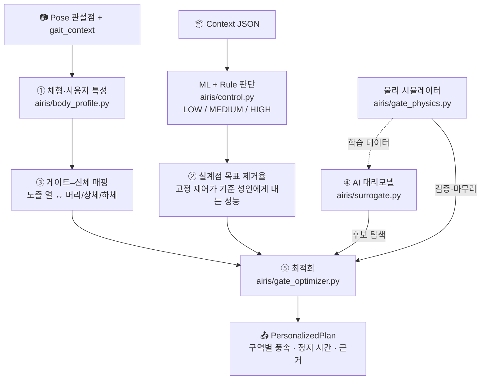

# Personalized Air Gate — 체형·사용자 특성 기반 물리 시뮬레이션–AI 융합 최적화

> **변경 제안 주제**: 체형·사용자 특성 기반 물리 시뮬레이션–AI 융합 사용자 맞춤형 에어게이트 최적화 시스템
>
> 기존 판단 계층([CONTROL_LOGIC.md](CONTROL_LOGIC.md))이 정한 제어 수준을, 지금 게이트에 선 사람의 몸에 맞는 노즐 풍속·정지 시간으로 바꾸는 계층의 설계 문서.

---

## 1. 기존 MVP에 없던 것

기존 파이프라인은 "**얼마나 세게**"까지만 답했다.

```text
Context → ML + Rule → LOW / MEDIUM / HIGH → 고정 Actuation (fan 30 / 65 / 100 %)
```

`fan_level=100`은 키 1.15 m 어린이에게도, 1.85 m 작업자에게도 똑같이 나간다. 새 주제가 요구하는 요소가 모두 비어 있었다.

| 새 주제의 요소 | 기존 상태 | 이번에 추가한 것 |
| --- | --- | --- |
| **체형** | 포즈 관절점은 보행 지표에만 사용 | `airis/body_profile.py` — 관절점 → 신장·어깨폭·신체 구역 |
| **사용자 특성** | 없음 | `UserTraits` — 보행속도·이동성·연령대·민감도·의류 |
| **물리 시뮬레이션** | 없음 (제어 수준 → 고정 표) | `airis/gate_physics.py` — 제트 감쇠·입자 탈리·하중·팬 에너지 |
| **AI 융합** | 위험도 분류용 Softmax만 존재 | `airis/surrogate.py` — 시뮬레이터 대리 신경망 + 물리 검증 |
| **맞춤 최적화** | 없음 | `airis/gate_optimizer.py`, `airis/personalization.py` |

기존 계층은 그대로 둔다. 제어 수준은 여전히 ML + 규칙이 정하고, 새 계층은 그 수준을 **어떻게 전달할지**만 결정한다.

---

## 2. 전체 파이프라인



---

## 3. ① 체형·사용자 특성

### 체형 (`BodyProfile`)

YOLO Pose의 COCO 17 관절점과 보행 분석이 이미 쓰는 화면 폭 보정값(`calibration_width_m`)만으로 추정한다.

| 항목 | 추정 방법 |
| --- | --- |
| 신장 | (발목 − 어깨) / 0.779 와 (발목 − 코) / 0.871 의 평균 |
| 어깨폭 | 정면: 양 어깨 관절 거리 실측 · 측면: 신장 × 0.259 |
| 골반폭 | 신장 × 0.191 × (어깨 기준 체격 계수) |
| 체중 | **측정 불가** — 체격별 BMI 사전값 × 신장² |

분절 비율은 Drillis & Contini (1966) 성인 평균값이다(Winter, *Biomechanics and Motor Control of Human Movement* 수록). 한 프레임은 흔들리므로 `BodyProfileTracker`가 최근 15프레임의 중앙값을 쓴다.

몸은 세 구역으로 나뉜다. 구역마다 높이 범위·반폭·표면적이 다르고, 이 값이 물리 모델의 입력이다.

| 구역 | 높이 범위 (서 있을 때) | 반폭 | 표면적 비율 (성인 / 어린이) |
| --- | --- | --- | --- |
| HEAD | 0.818 H ~ H | 0.045 H | 9 % / 14 % |
| UPPER | 0.530 H ~ 0.818 H | 어깨폭 × 1.12 / 2 | 55 % / 52 % |
| LOWER | 0 ~ 0.530 H | 골반폭 / 2 | 36 % / 34 % |

휠체어 사용자는 `posture="SEATED"`로 별도 처리한다. 하체 구역 폭은 골반이 아니라 휠체어가 정한다.

### 사용자 특성 (`UserTraits`)

| 특성 | 출처 | 쓰이는 곳 |
| --- | --- | --- |
| 보행속도 | `gait_context` 실측 | 통과 노출 시간 |
| 이동성 (NORMAL / SLOW / ASSISTED) | 보행속도 < 0.8 m/s 또는 비대칭 ≥ 0.2 | 안전 한계 |
| 연령대 (CHILD / ADULT / SENIOR) | 신장 < 1.35 m면 CHILD, 그 외는 등록 정보 | 안전 한계 |
| 민감도 (산모·호흡기 등) | **시설 등록 정보만** | 안전 한계 |
| 의류 (LIGHT / NORMAL / BULKY) | 입력 | 입자 부착력 |

> **설계 원칙**: 임신 여부·나이 같은 민감 특성은 카메라로 추정하지 않는다. 신장으로 고르는 것은 "보수적 한계를 적용할지"뿐이고, 신원이 아니다.

6개 페르소나가 [`assets/user_profiles/`](../assets/user_profiles/)에 커밋되어 있다.

---

## 4. ③ 물리 시뮬레이션

**CFD가 아니다.** 교과서 수준의 난류 제트 스케일링과 입자 탈리 곡선을 닫힌 형태로 엮은 축소 차수 모델이다. 목적은 절대값 예측이 아니라 **몸이 달라지면 답이 달라지는 구조**를 담는 것이다.

### 게이트 (`GateGeometry`)

통로 폭 0.90 m, 제트 구간 길이 1.20 m, 양쪽 기둥에 직경 30 mm 원형 노즐 10열(높이 0.15 ~ 1.95 m, 0.20 m 간격) × 열당 2개, 최대 풍속 20 m/s, 최대 정지 12초.

### 계산 순서

| 단계 | 식 | 몸이 바꾸는 것 |
| --- | --- | --- |
| 노즐 열 배정 | 열 높이가 속한 신체 구역. 머리 위 열은 **닿는 몸 없음** | 키 |
| 이격 거리 | `x = W/2 − 구역 반폭` | 어깨폭·골반폭 |
| 표면 도달 풍속 | `U_s = v₀ · min(1, B·d / x)`, B = 6.0 | 넓은 몸일수록 세게 맞는다 |
| 세정 띠 폭 | `2·k·max(d/2, S·x) + 수직 스윕`, S = 0.094 | 구역 길이 대비 덮는 비율 |
| 입자 탈리율 | `f(U) = (U/U₅₀)ⁿ / (1 + (U/U₅₀)ⁿ)` | 의류가 U₅₀을 올린다 |
| 시간 누적 | `1 − exp(−t/τ)`, `t = L/보행속도 + 정지` | 보행속도 |
| 제거 효율 | 구역별 (덮는 비율 × 탈리율 × 시간) 의 표면적 가중합 | 구역 면적 |
| 얼굴 풍속 | 머리 구역 열의 `U_s` | 머리 폭 |
| 측면 하중비 | `Σ n·ρ·A·v₀² / (m·g)` | 체중 |
| 팬 전력 | `Σ Q·Δp / η` ∝ v₀³ | — |

제트 상수 B와 S는 원형 자유 난류 제트의 표준값이다(Pope, *Turbulent Flows*: B ≈ 5.8, S ≈ 0.094).

### 가정값 — 실험으로 교체해야 하는 것

아래는 근거 문헌이 아니라 **자리표시자**다. 전부 `PhysicsParams`와 모듈 상수에 모여 있어 최적화 코드를 건드리지 않고 교체된다.

| 가정 | 현재 값 | 교체 방법 |
| --- | --- | --- |
| 탈리 임계 풍속 U₅₀ (조대 / 미세) | 6 / 14 m/s | 챔버 실험: 풍속별 의류 잔류 입자 계수 |
| 탈리 곡선 기울기 n | 3.0 | 위 실험 피팅 |
| 시간 상수 τ | 4 s | 노출 시간별 제거율 실험 |
| 의류 부착 계수 (LIGHT / NORMAL / BULKY) | 0.90 / 1.00 / 1.25 | 소재별 실험 |
| 세정 반경 계수 k, 수직 스윕 | 2.0, 0.12 m | 유동 가시화 또는 CFD |
| 미세 입자 비율 | PM2.5 / PM10, 없으면 0.4 | 현장 분진 분석 |

### 안전 한계

| 사용자 | 얼굴 도달 풍속 | 측면 하중 / 체중 |
| --- | --- | --- |
| 일반 성인 | ≤ 10 m/s | ≤ 2.0 % |
| 보행 약자 (SLOW) | ≤ 8 m/s | ≤ 1.2 % |
| 어린이·고령·민감·보조기구 | ≤ 6 m/s | ≤ 1.2 % |

얼굴 풍속은 Lawson 보행자 풍환경 기준(업무 보행 10 / 산책 8 / 서 있기 6 m/s)을 차용했다. 게이트는 거리가 아니므로 **피험자 실험의 출발값**이다. 하중비 한계는 설계 가정이다.

---

## 5. ④ AI 융합 — 대리모델

### 왜 필요한가

현재 시뮬레이터는 닫힌 식이라 1회 호출이 마이크로초다. 지금 당장은 대리모델이 시간을 벌어주지 않는다. 대리모델이 있는 이유는 **시뮬레이터가 교체될 부품**이기 때문이다. `simulate()`가 CFD나 챔버 실측으로 바뀌면 1회가 분 단위가 되고, 게이트는 사람이 들어서는 1초 안에 답해야 한다.

### 무엇을 학습하고 무엇을 학습하지 않는가

| 출력 | 담당 | 이유 |
| --- | --- | --- |
| 제거 효율 (전신 + 구역 3개) | **신경망** | 유동–입자 상호작용. 시뮬레이션이 필요한 유일한 부분 |
| 팬 에너지 | 해석식 | 팬 법칙(∝ v³). 학습할 이유가 없다 |
| 얼굴 풍속 · 측면 하중 | 해석식 | 제트 이론. 안전 판단을 신경망에 맡기지 않는다 |

### 모델

25 → 64 → 64 → 4 tanh MLP. `ml_policy.py`와 같은 원칙으로 **NumPy만** 쓰고 가중치를 [`assets/policy/gate_surrogate.json`](../assets/policy/gate_surrogate.json)에 평문 커밋한다.

입력 25개 중 13개는 원시값이 아니라 **제트 이론이 주는 특징**이다 — 구역별 도달 속도비, 덮는 비율, 활성 열 수, 표면 풍속, 그리고 노출 시간. 신경망이 1/x 감쇠를 데이터에서 다시 발견할 필요가 없다.

### 학습 결과

`python tools/train_gate_surrogate.py` (seed 20260930). 합성 사용자 1,500명 × 설정 32개 = 48,000건 학습, **처음 보는** 사용자 300명 × 32개 = 9,600건 평가.

| 출력 | R² | MAE |
| --- | --- | --- |
| 전신 제거 효율 | 0.9998 | 0.0012 |
| 머리 / 상체 / 하체 | 0.9999 | 0.0011 / 0.0016 / 0.0011 |

> **정직한 한계**: R² 0.9998은 "신경망이 물리 법칙을 맞혔다"가 아니라 "**매끄러운 닫힌 식을 흉내 냈다**"는 뜻이다. 기준이 CFD나 실측으로 바뀌면 이 숫자는 내려간다. 지금 검증된 것은 파이프라인 — 데이터 생성 → 학습 → 최적화 투입 → 물리 검증 — 이 끝까지 돈다는 사실이다.

---

## 6. ⑤ 최적화

### 문제 정의

결정 변수 4개: 머리·상체·하체 구역 노즐 풍속, 정지 시간.

```text
minimize    에너지/E_고정 + w_t · 통과시간/t_고정 + w_c · (얼굴풍속/한계)² + w_b · 구역 소홀
subject to  제거 효율 ≥ 목표
            얼굴 풍속 ≤ 사용자 한계      (투영으로 강제)
            측면 하중 ≤ 사용자 한계      (투영으로 강제)
```

- **목표 제거율은 지어낸 숫자가 아니다.** 판단 계층이 내린 고정 Actuation이 *설계 기준 성인*(1.70 m, 65 kg)에게 내는 제거율이다. "기준 체형이 받던 성능을 모든 체형에게"가 목표다.
- **안전 한계는 벌점이 아니라 투영이다.** 두 한계 모두 설정값의 닫힌 식이라, 후보를 평가하기 전에 안전 영역 안으로 끌어넣는다. 탐색 도중에도 안전하지 않은 설정은 존재하지 않는다.
- **구역 소홀 항**: 전신 평균만 맞추면 하체 노즐을 꺼서 에너지를 아끼는 해가 나온다. 각 구역이 목표의 60 %에 못 미치면 비용이 붙는다.
- **`w_t`는 맥락에서 온다.** 혼잡도 LOW 0.3 / MEDIUM 0.6 / HIGH 1.0. 줄이 길면 정지 시간을 줄이고 풍속으로 보상한다.

### 탐색

차분 진화(rand/1/bin) + Deb의 실현 가능성 규칙. 목표를 못 채우는 경우 제거율이 높은 쪽이 이긴다 — 즉 **안전 영역 안에서 가장 깨끗한 설정**으로 수렴한다.

| 방식 | 절차 | 시뮬레이터 호출 |
| --- | --- | --- |
| `PHYSICS` | 모든 후보를 시뮬레이터로 평가 | 2,841 |
| `SURROGATE+PHYSICS` | 대리모델로 탐색(안전 여유 3단계) → 후보 9개를 시뮬레이터로 검증·마무리 | 133 |

페르소나 6 × 제어 수준 3 = 18건에서 두 방식을 비교한 결과:

| 지표 | 값 |
| --- | --- |
| 목표 상태 일치 | 18 / 18 |
| 제거율 차이 | 평균 0.0004, 최대 0.0021 |
| 목적함수 차이 | 평균 +0.4 %, 최대 +3.3 % |
| 시뮬레이터 호출 | 2,841 → 133 (약 21배 감소) |

> **정직한 한계**: 현재 시뮬레이터에서는 `SURROGATE+PHYSICS`가 벽시계 시간으로 **더 느리다**(계획 1건당 약 35 ms 대 14 ms). 이득은 호출 횟수이고, 호출 1회가 비싸질 때만 시간 이득으로 바뀐다.

### 목표 상태

| 상태 | 조건 | 처리 |
| --- | --- | --- |
| `MET` | 제거율 ≥ 목표 | 정상 |
| `WITHIN_TOLERANCE` | 목표 − 2 %p 이내 | 기록만 |
| `SHORTFALL` | 그보다 미달 | `needs_attendant = True`, 관리자 확인 |

---

## 7. 실행 결과

`python tools/run_personalization.py` → [`assets/reports/personalization_report.json`](../assets/reports/personalization_report.json). 혼잡도 LOW, 미세 입자 비율 0.4 기준.

### HIGH (고정: 전 열 20 m/s, 정지 9초 · 목표 62.6 %)

| 사용자 | 고정 제거율 | 고정 안전 | 맞춤 제거율 | 맞춤 얼굴 풍속 | 에너지 (Wh) | 통과 (s) | 상태 |
| --- | --- | --- | --- | --- | --- | --- | --- |
| P1 표준 성인 | 63.0 % | 이내 | 62.6 % | 8.0 m/s | 1.02 → 0.77 | 9.9 → 10.6 | MET |
| P2 어린이 | 47.5 % | **얼굴 9.0 m/s, 하중 2.0 %** | 42.9 % | 5.5 m/s | 1.05 → 0.40 | 10.2 → 13.2 | SHORTFALL |
| P3 고령 보행 약자 | 62.0 % | **얼굴 9.5 m/s** | 62.3 % | 6.0 m/s | 1.13 → 0.94 | 11.0 → 14.0 | WITHIN_TOLERANCE |
| P4 큰 체형 작업복 | 50.3 % | 이내 | 52.8 % | 9.8 m/s | 1.01 → 1.19 | 9.9 → 12.9 | SHORTFALL |
| P5 산모 (등록) | 65.8 % | **얼굴 9.6 m/s** | 62.7 % | 6.0 m/s | 1.08 → 0.57 | 10.5 → 11.1 | MET |
| P6 휠체어 | 61.1 % | **얼굴 9.7 m/s** | 61.2 % | 6.0 m/s | 1.10 → 0.74 | 10.7 → 13.7 | WITHIN_TOLERANCE |

### 읽는 법

- **고정 제어는 18건 중 7건에서 사용자 안전 한계를 넘는다.** 넘는 쪽은 전부 취약 사용자다.
- **P1**: 같은 제거율을 에너지 24 % 적게. 머리 위 2열을 끄고 머리 구역 풍속을 낮춘 뒤 정지 0.7초로 보상했다.
- **P5**: 고정 제어는 얼굴에 9.6 m/s를 보낸다. 맞춤 제어는 6.0 m/s로 묶고도 목표를 채우며 에너지는 47 % 줄었다.
- **P2**: 고정 제어는 어린이를 **덜 닦으면서 더 세게 민다**(제거율 47.5 %, 하중 2.0 %). 맞춤 제어는 한계 안에서 42.9 %가 최대이고, 이를 숨기지 않고 관리자 확인으로 올린다.
- **P4**: 부피 큰 의류는 최대 풍속·최대 정지로도 52.8 %다. 고정 제어(50.3 %)보다 낫지만 에너지는 **18 % 더 든다.** 맞춤이 항상 절약은 아니다.
- **MEDIUM에서 P2·P4**: 고정 제어가 목표에 12 %p, 9 %p 미달한다. 맞춤 제어는 에너지를 45 %, 87 % 더 써서 목표를 채운다.

전체 18건 중 16건이 한계 안에서 목표(허용 오차 포함)를 지켰다.

---

## 8. 연동 지점

| 파일 | 변경 |
| --- | --- |
| `posture_analysis.py` | 포즈 추론마다 `BodyProfileTracker` 갱신, `body_context`를 상태에 추가 |
| `live_context_store.py` | `write_user_profile` / `read_user_profile` |
| `integrated_context.py` | `analyze_personalized_context()` — 맥락 판단 + 맞춤 계획을 한 번에 |
| `realtime_vision_app.py` | `보행 분석`에 추정 신장·어깨폭 표시, `맞춤 최적화` 모드 추가 |
| `personalized_gate_app.py` | 카메라 스택 없이 도는 단독 대시보드 |

```python
from integrated_context import analyze_personalized_context

context, decision, plan = analyze_personalized_context(
    vision, health, environment, facility, user_profile
)
plan.setpoints          # GateSetpoints(head, upper, lower, hold)
plan.personalized.rows  # 노즐 열별 풍속
plan.reasons            # 왜 이렇게 바꿨는지
plan.needs_attendant    # 안전 한계 때문에 목표 미달
```

---

## 9. 실행

```bash
python tools/train_gate_surrogate.py      # 대리모델 재학습 → assets/policy/gate_surrogate.json
python tools/run_personalization.py       # 페르소나 비교 → assets/reports/personalization_report.json
python -m unittest tests.test_body_profile tests.test_gate_physics tests.test_personalization
streamlit run personalized_gate_app.py --server.port 8504
```

게이트 형상이나 물리 상수를 바꾸면 대리모델의 `gate_signature`가 어긋나 자동으로 `PHYSICS` 방식으로 떨어진다. 다시 학습하면 복구된다.

---

## 10. 남은 일

| 우선순위 | 항목 | 교체되는 코드 |
| --- | --- | --- |
| 1 | 챔버 실험으로 탈리 곡선(U₅₀, n, τ) 보정 | `PhysicsParams` |
| 2 | 대표 체형 몇 개에 대한 CFD(OpenFOAM)로 도달 풍속·세정 띠 검증 | `gate_physics.simulate` |
| 3 | CFD 결과로 대리모델 재학습 또는 잔차 학습 | `tools/train_gate_surrogate.py` |
| 4 | 피험자 실험으로 얼굴 풍속·하중 한계 확정 | `FACE_VELOCITY_LIMIT_MPS`, `LATERAL_LOAD_LIMIT` |
| 5 | 체형 추정 정확도 검증 (Kuopio MoCap 대조) | `body_profile.estimate_body_profile` |
| 6 | 어린이 분절 비율, 체중 추정 개선(깊이 카메라 또는 바닥 하중 센서) | `body_profile` |
| 7 | 실제 노즐 열 단위 제어 하드웨어 | `GateGeometry` |

## ⚠️ 사용 제한

이 계층의 수치는 **축소 차수 모델과 합성 페르소나**에서 나왔다. 제거 효율의 절대값, 안전 한계, 에너지는 실험으로 확인되지 않았다. 실제 사람을 대상으로 한 풍속 제어에 쓰기 전에 10절의 1·2·4번이 선행되어야 한다.
